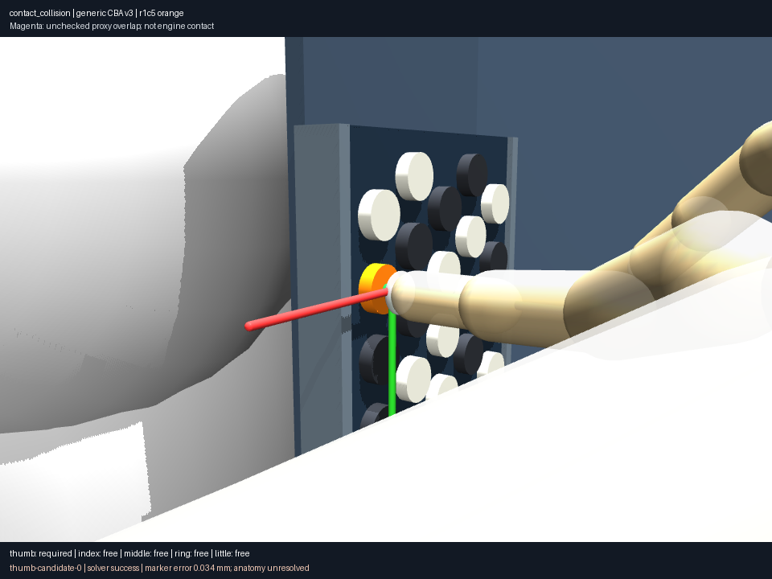
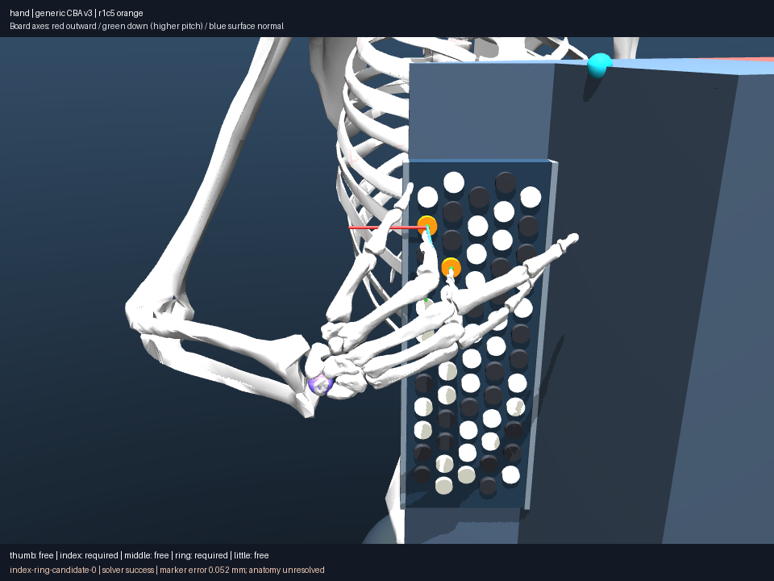
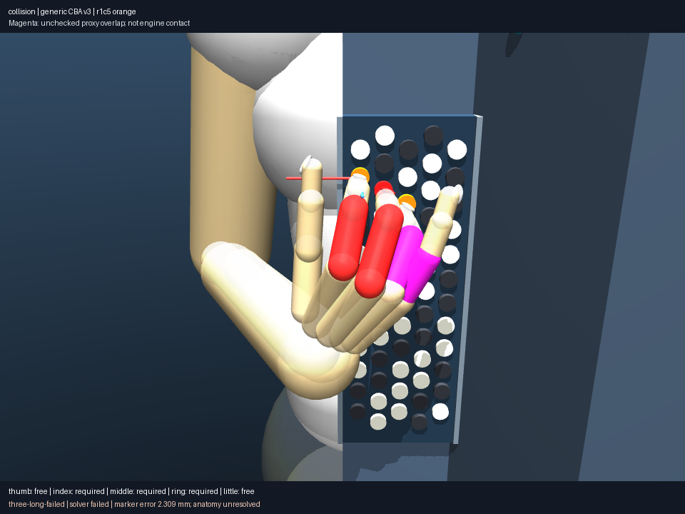
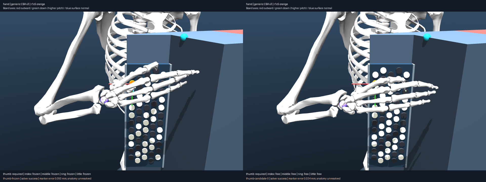

# Five named contacts and free unassigned digits

The fixed 037 compact generic CBA v3, seated native full-body-derived player,
closed bellows, prescribed left arm and finite board remain unchanged. No proxy,
mask, anatomical joint range, instrument dimension or wearing transform changed.

`contacts.json` defines nine requests, five deterministic starts each and 220
iterations per start, plus one template solve per request (54 solves total).
Displacement limits and sampled integration backtracking remain explicit. The
same 037 central saved configuration seeds every request. The whole right arm,
wrist and all five digits can articulate; posture regularization targets the
start. Independent coordinates do not establish biological independence.

| Request | Distinct candidates | Successful starts / 5 |
|---|---:|---:|
| thumb C4 r1c5 | 3 | 3 |
| index C4 r1c5 | 2 | 3 |
| middle C4 r1c5 | 3 | 3 |
| ring C4 r1c5 | 3 | 3 |
| little C4 r1c5 | 3 | 3 |
| index C4 + ring E4 r2c6 | 2 | 3 |
| index C4 + little E4 | 0 | 0 |
| index C4 + middle C#4 + ring D4 | 0 | 0 |
| thumb C4 + index C#4 | 0 | 0 |

There are 16 distinct candidates from 18 accepted and 27 failed starts. Failed
starts and template states remain in `free/`; finite search failure is not an
impossibility claim. In particular the three-contact template retains 2.309 mm
maximum marker error and 0.068 mm independently queried instrument penetration.
Thumb/index's failed template retains 63.773 mm marker error. Unsupported or
failed coordinated specifications are never promoted to successful contacts.

## Imported geometry, including thumb

Bindings use named imported subtrees, four coordinates per digit and original
joint equalities. Every marker is on the outer support of the compiled distal
capsule/ellipsoid union. Long-digit capsules point distally along local +z;
the thumb capsule's +z points proximally. Its ellipsoid displacement projects
−13.173 mm along that capsule axis. Thumb contact uses −z, with the site normal
reversed accordingly. This is a rigid-envelope distal contact hypothesis, not
an observed fleshy patch or a calibrated thumb technique. Bone meshes and
collision envelopes differ visibly; the envelope is not shortened to match a
preferred pose. The little-finger geometry names have a different imported
prefix and are bound explicitly.

Five-finger requests, distinct assignments, multistart solving, released
transitions with different source/destination fingers and named held/moving-pair
workflows are generalized. The historical paired held workflow still requires
the same moving digit at its two endpoints and rejects substitutions explicitly;
changing contact sets and sequence-level search are the next milestone.

## Independent diagnostics and images

Canonical collision coverage runs on all 16 candidates, three failed templates
and the frozen-thumb comparison. `diagnostics/result.json` also queries all 276
hand pairs independently of engine masks, with exact source state hashes.
All accepted candidates have positive minimum instrument proxy clearance at
these saved states (22–99 micrometres for single contacts; 35 micrometres for
the index/ring dyad). This does not show continuous or anatomical validity.
Unchecked cross-digit phalangeal distances reach −8.729 mm. These are unresolved
rigid-proxy overlaps, not measured tissue penetration. The configured index/middle
pair hypotheses do not become full five-finger collision coverage.

Eight representative states have overview, keyboard, side, full-hand, contact,
collision and contact-collision views. Required cap(s) are orange; required pad
markers green; unassigned fingers are explicitly labeled free or frozen. Magenta
highlights the worst unresolved phalangeal pair. Red shows engine penetration.
Failed-state captions say failed and give actual marker residuals. All media
come from saved qpos and compiled model identity. The close camera initially
looked through the case; rejected camera probes stay in scratch, and the selected
side angle exposes the thumb envelope without hiding other digits. The shared side close-up is occluded for ring;
`ring-detail.json` preserves a front close-up showing the cap and overlapping
proxies instead. Neither image is a contact certificate; numerical distances
and the named site binding remain authoritative.





## Frozen versus free comparison

`thumb-frozen.json` changes only the unassigned-digit policy and its provenance
from the same exact initial qpos and solver settings as thumb start 0. Both
solves meet endpoint tolerances; free/frozen thumb marker errors are
34/50 micrometres. Free middle proximal-coordinate change is 0.178 rad and ring
MCP flexion changes 0.130 rad; frozen unassigned coordinates stay at their start.
The largest full-state difference is 0.592 rad, including arm and thumb.
Neither posture is labeled more natural. Their worst unresolved phalangeal
proxy distances are −4.772/−8.652 mm respectively.



`comparison.json` requests identical cameras for both states. Its images show
frozen on the left and free on the right, with exact state-source links and no
interpolation. A first frozen solve could not render because an import loaded
MuJoCo before EGL selection; moving topology constants to an engine-free module
fixed that execution failure. The subsequent frozen run solved and rendered.

## Reproduce and scope

```sh
uv run aec frozen explore experiments/041-five-finger-contacts/contacts.json --output artifacts/041-replay
uv run aec frozen collision-coverage experiments/041-five-finger-contacts/coverage.json --output artifacts/041-coverage-replay
uv run aec frozen contact-report experiments/041-five-finger-contacts/diagnostics.json --output artifacts/041-render-replay
uv run aec frozen contact-report experiments/041-five-finger-contacts/comparison.json --output artifacts/041-comparison-replay
```

For exact executed algorithms add `--source-snapshot` with the corresponding
published root's `source-snapshot.zip`. New execution metadata's
`definition_reference` links the unchanged executed definition in the parent;
verification checks its exact hash and referenced source states. No old frozen
record was rebased or rewritten. Integrity verification is not physical truth.

The catalog adds nine named controls, including three unsuccessful searches,
with explicit registered model/contact-policy variants and links to diagnostics.
The musical event/assignment API also enumerates all digits and duplicate buttons
without claiming those hypotheses have been numerically tested. This milestone
has static coordinated evidence; it is not yet a five-finger passage engine.
Connected changing assignments, algorithm-derived branch records and actual
sampled animations follow in 042, then autonomous generation and reuse in 043–044.
