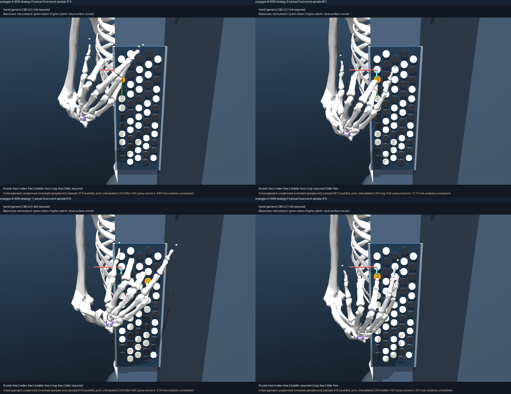
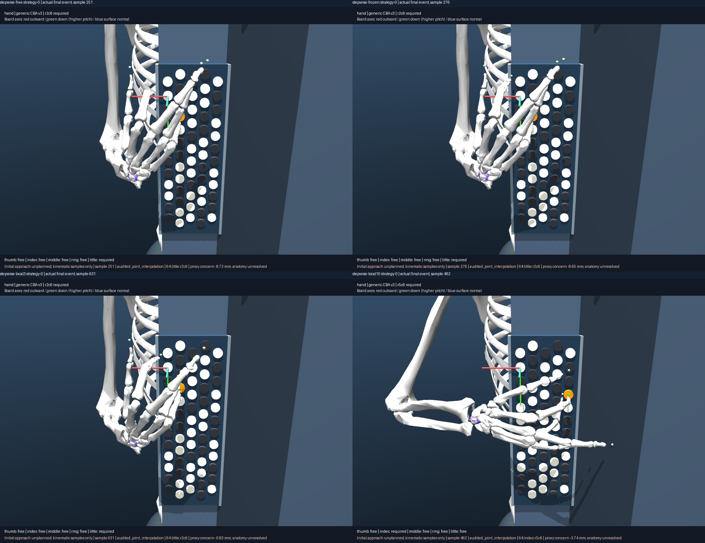

# 048 — Versioned reassessment, complete-path selection and reusable evidence

The [biomechanics-v1 sidecar](assessment/result.json) covers all **50 historical
targets and 53 realizations** without changing `targets/manifest.json` or their
IDs. Nine benchmark cases have deep posture/conditional muscle evidence; other
entries explicitly remain unassessed at those levels. Musical intent, contact
pose, sampled connection, configured checks, unresolved proxies, whole-hand
analysis, conditional static capacity, dynamic execution and human validation
are separate fields. There is no generic ergonomic or feasible label.

## What explains the original strategies

[The matched 047 search comparison](../047-whole-hand-comparison/notes.md)
reproduces the original little-heavy arpeggio strategies exactly. At the first
event all four attempted contacts succeed with zero accumulated palm cost;
seeded assignment order and node-ID tie breaking retain the first two little
finger hypotheses. Later palm-only pruning favors a shorter little-ending
branch. Changing the seed changes the retained fingering substantially. Thus
ordering, finite budget and geometric objective demonstrably contribute;
these data do not establish a strength advantage or anatomical necessity.
The historical thumb and little alternatives had unequal discovery budgets,
so their old palm lengths alone cannot identify the cause.

Whole-hand beam selection reduces wrist variation in both tested seeds, yet
seed 4309 is a collision counterexample: endpoint descriptors overlook worse
intermediate overlap. The full-path reassessment below exposes it. Technique
ordering changes exploration toward fingers 2/3/4 while retaining all five;
its outcome and wrist benefit depend on the seed. Local-reference regularization
can increase wrist motion and free-digit articulation after switching branches.
No tested heuristic establishes natural coordination or ordinary playing.

[The 046 muscle audit](../046-muscle-validation/notes.md) finds native/reduced
agreement for the 63 actuators and 67 tendons, but inherited PQ/DELT3 route
jumps and localized derivative discrepancies undermine global effort ranking.
No equilibrium is found in 220 original static scenarios or 216 matched-search
endpoint scenarios under their stated no-other-support, 0/1/3 N hypothetical
reaction assumptions. Different objectives do not change that gate; unknown
support reactions and inherited parameter/routing limitations prevent a human
capacity interpretation. Muscle-screened selection is explicitly unsupported.
The corrected seed supplement below qualifies two original probes.

## Initial-pose correction

[The solved-seed supplement](seed/result.json) uses exact q from the hashed 037
C4 solution, not the stale original input dictionary in historical passage
`scene_input`. Its equality residual is 2.8e-17 rad; the old input's is 0.3 rad.
A matched synthetic wrist/MCP sensitivity pose is equality-consistent but
violates geometric checks; its collision overlay remains visible. Neither
resolved posture finds equilibrium under zero/1/3 N synthetic reactions and
both recruitment objectives. The historical uncoupled input remains an explicit
negative diagnostic, ineligible for ideal-constraint equilibrium.

Historical 045/046 numerical and render files remain intact. The sidecar names
the two affected 046 probes and marks old seed dictionaries as original inputs,
not executed seeds. New passage records materialize replaced joints and retain
resolved `initial_qpos_rad`; no seed-to-first-note approach is invented.

## Complete-path strategy reassessment

`audited_strategy_order` requires matching complete movement audits and uses the
worst actual sampled cross-digit distance, alongside palm length and wrist/digit
variation. Pareto layers preserve alternatives. The optional `proxy_first` or
`wrist_first` tie preference is explicit, not an empirical comfort scale.
Configured-check rejection remains an explicit outcome. No muscle effort term
is included: the available conditional screens do not support one.

For B4309, proxy-first selects **3/2/3/5** over **3/2/3/4**, while wrist-first
chooses the reverse. The retained little-finger ending has -3.234 mm worst proxy
distance versus -13.599 mm for the ring ending. This corrects the blind spot of
endpoint-only selection without altering or smoothing either physical path.
The lower-overlap strategy still has unresolved anatomy; neither is certified
ordinary playing. All 20 new paths passed configured and instrument checks and
all retained some unconfigured cross-digit overlap.

The local-reference x10 policy is preserved as a counterexample: shorter palm
movement coincides with much more wrist variation. Its matched render shows an
actual changed hand/forearm configuration, not merely a relocated marker. It is
not made the default. All five fingers remain available and the autonomous
musical generation engine remains intact; no extra catalog entries substitute
for this quality work.

## Selected visual evidence

The comparisons below use literal saved final-event pixels with identical
camera/model identities and equivalent musical events. Their source frames,
exact q/roles/contact requirements, sample indices and hashes are in the sidecar.
They are final-event comparisons, **not worst-sample comparisons**.





- [A arpeggio actual-sample animation](../047-whole-hand-comparison/arpeggio-A-4309-media/strategy-0/trajectory.gif)
- [B lower-overlap little ending animation](../047-whole-hand-comparison/arpeggio-B-4309-media/strategy-1/trajectory.gif)
- [D optional technique-prior animation](../047-whole-hand-comparison/arpeggio-D-4309-media/strategy-0/trajectory.gif)
- [B ring-ending worst sample](../047-whole-hand-comparison/arpeggio-B-4309-media/strategy-0/worst-state/collision.png)
- [Actual B beam criteria](assessment/arpeggio-B-4309-beam-criteria.svg)
- [Resolved seed versus extreme/old input data and four views](seed/result.json)
- [Held failure evidence, no successful animation](../045-strategy-audit/media/held-incomplete/worst-state/collision.png)

GIF speed is illustrative, paths are untimed kinematic samples, and all initial
approaches remain unplanned. Plots of beam candidates describe actual algorithm
records, not physical intermediate states. Static coefficients are not neural
activation overlays or a muscle-driven simulation.

## Import and reproduce

See [the tested consumer](../../examples/quality_consumer.py) and
[API guide](../../targets/API.md). Another project can inspect assessments,
rank recorded alternatives, retrieve exact trajectories/frames and conditional
screens, or obtain archived-code replay arguments without browsing folders.

```sh
uv run aec frozen seed-capacity experiments/048-library-reassessment/seed.json --output artifacts/048-seed
uv run aec frozen quality-assessment experiments/048-library-reassessment/assessment.json --output artifacts/048-assessment
uv run aec verify experiments/048-library-reassessment/seed experiments/048-library-reassessment/assessment --require-complete
```

Use matching published `source-snapshot.zip` files for exact replay. The source
trajectories remain those of 042/043/047; the new gallery is a reproducible
composition of their recorded frame files, not new physical evidence.

## Research disposition

Retain all historical results as kinematic/negative evidence. Downgrade any
ordinary-playing interpretation of deeply audited paths to **not established**.
Under the explicitly stated strict rigid-proxy policy, every benchmark path is
rejected for negative unconfigured cross-digit distance; this is not a calibrated
human impossibility claim. Keep held failure as incomplete movement evidence.
Leave unexamined legacy postures/muscle capacity unassessed. Dynamic capacity,
comfort, endurance, skin calibration and actual button/support reactions remain
unvalidated. These boundaries are exposed by the API, not hidden by images.
